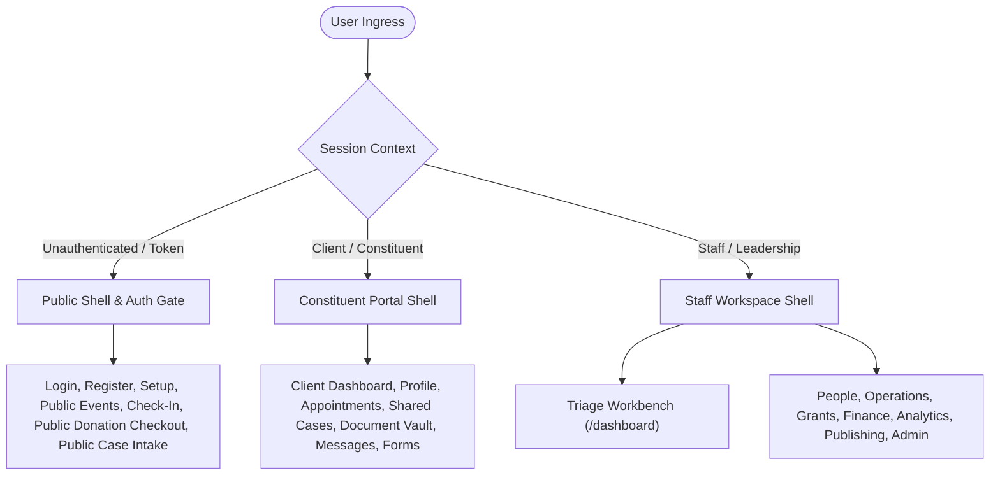

# Comprehensive UI/UX Usability, Functionality & Expected Working Functions Review

**Repository:** Nonprofit Manager  
**Scope:** Complete Browser Application Surfaces (Staff Workspace, Constituent Portal, Public Workflows, and Administration)  
**Evaluation Standard:** Usability, Information Architecture, WCAG 2.1 AA Accessibility, Persona Ergonomics, State Resilience, and Interaction Design  

---

## Executive Summary & System Architecture

Nonprofit Manager implements an operations-grade browser workspace structured around three core boundaries:
1. **Authenticated Staff Workspace:** An operational engine for nonprofit staff across cases, donors, volunteers, grants, analytics, communications, and administration.
2. **Constituent / Client Portal:** A dedicated, client-facing environment prioritizing agency, privacy, appointments, document exchange, and secure communications.
3. **Public / Unauthenticated Engine:** Lightweight, responsive workflows for public event check-in, donation checkouts, community referral forms, user onboarding, and password management.

### Visual Systems & Dual-Paradigm Design
The application features a hybrid visual architecture:
- **Neo-Brutalist / Editorial Ops (`LOOP` Design System):** Employs stark borders (`2px solid black`), flat cast-shadows (`4px 4px 0px #000`), saturated accent badges (Yellow `#FFD700`, Green `#90EE90`, Blue `#60A5FA`, Purple `#D8BFD8`), high-contrast typography, and explicit visual hierarchy. Used across the primary Workbench, Case management, People Directory, Operations Kanban, and Outreach Center.
- **Modern Enterprise Shell:** Features soft card radii (`var(--ui-radius-sm)` to `var(--ui-radius-md)`), subtle neutral borders, calm gray elevations, and restrained micro-interactions. Used across Administration, Reporting, Settings, Finance, and Portal views.
- **Dynamic Multi-Theme Engine (`THEME_REGISTRY`):**
  - **Editorial Ops (`neobrutalist`):** Paper-toned editorial rhythm with ink-first hierarchy.
  - **Sea Breeze (`sea-breeze`):** Marine palette with soft teal gradients for calm intake workflows.
  - **Corporate (`corporate`):** Disciplined enterprise clarity with sharp cobalt accents.
  - **Clean Modern (`clean-modern`):** Contemporary sage-forward workspace with smooth depth.
  - **Frosted Glass (`glass`):** Translucent backdrop filters and modern layered styling.
  - **High Contrast (`high-contrast`):** Maximized luminescence ratios for strict accessibility.

---

## Global Navigation & Ergonomics

### Top Navigation & Command Palette
- **Global Header (`Navigation.tsx`):** Sticky, elevated header with white-label brand logos, tenant name, active route subtitle, notifications quick-jump, user avatar dropdown, and theme switcher.
- **Global Quick Lookup (`Cmd + K`):** Built into `StaffNavigationQuickLookupDialog.tsx`. Features asynchronous debounced search across People, Cases, Notes, Donations, and Route destinations. Includes keyboard arrow navigation (`↑` / `↓`), enter-to-navigate, backdrop focus-trapping with `inert` sibling isolation, and explicit screen-reader announcements.
- **Surface Context Bar (`SurfaceContextBar.tsx`):** Persistent contextual strip providing breadcrumb trails, surface badges (e.g., `Staff workspace` vs `Client portal`), customizable pinned shortcuts (Favorites), and primary route actions.

### Responsive Drawer vs. Side Rail
- **Desktop Rail (`StaffSideNavigation.tsx`):** Expands on `lg:` viewports (≥1024px) grouped by core domain areas: `Work`, `People`, `Service`, `Engagement`, `Finance`, `Publishing`, `Insights`, `Admin`, and `Utilities`. Active routes display a visual accent indicator (`shadow-[inset_3px_0_0_var(--app-accent)]`).
- **Mobile Drawer (`MobileNavigationDrawer.tsx`):** Below 1024px, collapses into an accessible off-canvas drawer with body overflow locking, focus trapping, compact sections, and quick utility links. Mobile bottom bar exposes essential primary shortcuts without viewport obstruction.

---

## Domain-by-Domain Functional & Usability Audit

### 1. Operations & Triage Workbench (`/dashboard`, `/operations`, `/linking`)
* **Expected Working Functions:**
  - `WorkbenchDashboardPage`: Central triage dashboard displaying pending intakes, urgent follow-ups, portal escalations, and active queue counts.
  - `WorkbenchPanels`: Includes `FocusQueuePanel` (actionable cards requiring immediate attention), `InsightStripPanel` (key performance and financial indicators), `MyWorkPanel` (user-assigned tasks and appointments), and `WorkspaceSummaryPanel`.
  - `DashboardViewSettingsPanel`: In-place toggle for showing/hiding lanes, plus deep-link to `/dashboard/custom` layout editor.
  - `OperationsBoardPage`: Visual 3-column Kanban board (`TO DO`, `IN PROGRESS`, `DONE`) with category filtering (HR, Admin, Finance, Tech), due-date sorting, and assignees.
  - `LinkingModulePage`: Community partner and organizational relationship directory with live search and status indicators.
* **Usability & UX Strengths:**
  - Triage-first philosophy ensures staff are immediately presented with tasks and overdue cases upon login rather than vanity metrics.
  - High scannability with distinct color-coded badges and clear action triggers.
* **Friction Points & Gaps:**
  - Kanban board currently lacks drag-and-drop task progression (status updates must be performed via task detail or edit views).
  - Dense triage widgets can feel crowded on tablets in portrait mode (768px–1024px).

---

### 2. People, Contacts & Volunteer Operations (`/contacts`, `/accounts`, `/volunteers`, `/people`)
* **Expected Working Functions:**
  - `ContactListPage`: Paginated directory featuring real-time filter collapse panels (`FilterPanel`), active filter count badges, column sorting, individual row toggles, select-all, and a floating bulk action bar (`BulkActionBar`) with Export and Bulk Delete.
  - `ContactDetailPage`: Comprehensive constituent dossier containing:
    - Activity timeline (`ActivityTimeline`) with chronological notes, appointments, calls, and emails.
    - Household and organizational relationship links (`ContactRelationships`).
    - Dedicated sub-panels for Notes, Documents, Tasks, Donor Giving Preferences, Suppression rules, and Volunteer history.
    - Two-way duplicate resolution and record consolidation (`ContactMergeDialog`).
  - `ContactPrintPage` (`/contacts/:id/print`): Clean, print-formatted dossier stripping app chrome for paper files or board review.
  - `AccountListPage` & `AccountDetailPage`: Organizational partner records with subsidiary hierarchies and employee rosters.
  - `VolunteerListPage` & `VolunteerDetailPage`: Volunteer onboarding lifecycle, availability tracking, skill tag matching, and assignment scheduling (`AssignmentCreatePage`).
* **Usability & UX Strengths:**
  - Mobile card fallback: Switches seamlessly from dense desktop tables to mobile touch cards (`mobileCardRenderer`) on small screens.
  - Progressive disclosure: Contact detail hides inactive panels behind structured tabs to minimize cognitive overload.
  - Unsaved change protection: Prevents data loss when navigating away from dirty edit forms.
* **Friction Points & Gaps:**
  - Contact merge interface is information-dense; lacks side-by-side visual field conflict highlighting before execution.
  - Bulk actions currently support delete and export, but lack bulk tag application or mass reassignment.

---

### 3. Engagement, Direct Service & Case Management (`/cases`, `/events`, `/tasks`, `/follow-ups`)
* **Expected Working Functions:**
  - `CaseListPage`: Multi-criteria case filtering (Status, Priority, Program Type, Assignee, Overdue, Urgent) with saved filter views (`savedViews`). Includes quick filter chips and bulk status transition modals.
  - `CaseDetailPage`: Milestone tracking with visual progress bar, service logging (`CaseServices`), reassessment alerts (`CaseReassessmentPanel`), portal conversations tab (`CasePortalConversations`), and automated PDF case handoff packets (`CaseHandoffModal`).
  - `IntakeNewPage` (`/intake/new`) & `InteractionNotePage` (`/interactions/new`): Streamlined intake flow converting raw constituent interactions into structured cases and follow-ups.
  - `PublicCaseFormPage` (`/public/case-forms/:token`): Self-service community intake and client referral submission.
  - `EventsHubPage` & `EventCalendarPage`: Event scheduling, registration caps, recurring sessions, and calendar visualization.
  - `EventCheckInDeskPage`: High-speed check-in station with attendee lookup, QR scan support, and walk-in registration.
  - `PublicEventCheckInPage` (`/event-check-in/:id`): Kiosk/self-check-in interface for attendees on mobile devices.
  - `FollowUpsPage`: Dedicated escalation view for approaching deadlines and overdue touchpoints.
  - `TeamMessengerPage` (`/team-chat`): Real-time internal staff messaging channels and case-linked discussion threads.
* **Usability & UX Strengths:**
  - Clear priority indicators with semantic severity cues (`urgent` / `high` / `normal`).
  - Handoff packets enable compliant inter-agency transfers in one click.
  - Event check-in desk is optimized for high throughput with rapid keyboard shortcuts and instant feedback.
* **Friction Points & Gaps:**
  - Transitioning cases across statuses requires outcome definitions for certain closed states, which can cause validation confusion if outcome definitions are not clearly guided in the UI modal.
  - Case milestone reordering is not drag-and-drop; must be edited individually.

---

### 4. Finance, Giving & Grants Lifecycle (`/donations`, `/reconciliation`, `/grants/**`)
* **Expected Working Functions:**
  - `DonationListPage`: Transaction log with stat cards (Total Volume, Average Gift, Gift Count), payment method filters, campaign fund attribution, and tax receipt generation (`TaxReceiptModal` with single vs. annual summary receipts).
  - `DonationBatchReviewPage` (`/donations/batches`): Control-total verification, batch entry review, and reconciliation lock.
  - `ReconciliationDashboardPage` (`/reconciliation`): Bank statement feed matching, payout discrepancy flags, and ledger reconciliation.
  - `GrantsPage` & 11 sub-modules:
    - Grant Funders (`/grants/funders`) & Grant Programs (`/grants/programs`).
    - Applications Pipeline (`/grants/applications`) with stage progression.
    - Awards (`/grants/awards`) & Disbursement tracking (`/grants/disbursements`).
    - Compliance Reports (`/grants/reports`) & Grant Activity Log (`/grants/activities`).
    - Grant Deadline Calendar (`/grants/calendar`).
* **Usability & UX Strengths:**
  - Strict compliance checks: Tax receipt generation guards prevent premature generation of invalid receipts based on tax status.
  - Fundraiser direct links: Connects gift recording directly to opportunity pipelines and stewardship templates.
* **Friction Points & Gaps:**
  - The Grants module is split across 11 discrete sub-routes; while comprehensive, switching between funders, applications, and disbursements requires frequent navigation hops. A unified "Grant Lifecycle Command Center" view would significantly reduce click fatigue.

---

### 5. Analytics, Reports & Intelligent Alerts (`/analytics`, `/reports`, `/alerts`)
* **Expected Working Functions:**
  - `AnalyticsPage`: Interactive trend analytics using Recharts (Giving volume, Attendance trends, Volunteer hours, Comparative YoY metrics) with date range filters.
  - `ReportsHomePage`: Workflow-centric hub routing users by task:
    - Executive & Board Packet (`/reports/board-packet`): Assembles financials, service outputs, and risk logs into a review-ready view.
    - Custom Report Builder (`/reports/builder`): Drag-and-drop field selector, aggregation definitions, and grouping rules.
    - Report Templates (`/reports/templates`): Ready-to-run configurations for 990 prep, donor retention, and grant reporting.
    - Saved Reports (`/reports/saved`) & Scheduled Reports (`/reports/scheduled`): Automated email and CSV delivery configuration.
    - Outcomes (`/reports/outcomes`) & Workflow Coverage (`/reports/workflow-coverage`).
  - `AlertsConfigPage`, `AlertInstancesPage`, `AlertHistoryPage`: Rule builder for metric threshold breaches (e.g., donations drop, case backlog spike), active queue triage with acknowledge/resolve actions, and audit trail.
* **Usability & UX Strengths:**
  - Plain-language framing: Reports are organized by user role/intent rather than raw database tables.
  - Scheduled delivery eliminates manual recurring report generation.
* **Friction Points & Gaps:**
  - Visual chart tooltips on complex Recharts can overflow mobile screen edges if not clamped.
  - Custom report builder query execution does not show a percentage progress indicator for large datasets, relying instead on a general spinner.

---

### 6. Websites, CMS & Visual Builder (`/websites`, `/website-builder`)
* **Expected Working Functions:**
  - `WebsitesListPage` & `WebsiteOverviewPage`: Multi-site console, custom domain binding, SSL status, and site-wide metrics.
  - `WebsiteContentPage`, `WebsiteFormsPage`, `WebsiteNewslettersPage`, `WebsitePublishingPage`: Centralized management of public forms, newsletter subscriptions, integrations, and static site generation.
  - `PageEditorPage` (`/website-builder/:templateId`):
    - Visual drag-and-drop canvas powered by `@dnd-kit/core` and `@dnd-kit/sortable`.
    - Component palette (Hero, Columns, Testimonials, Referral Form, Donation Widget, Newsletter Signup, Event Registration).
    - In-place property inspector (`PropertyPanel`) for typography, colors, padding, button CTAs, and API form bindings.
    - Responsive viewport toggle (Desktop, Tablet, Mobile preview).
    - Undo/Redo history stack, auto-save status indicator, and instant preview modal.
* **Usability & UX Strengths:**
  - Seamless coupling of public forms to CRM tables (e.g., submitted referral forms automatically create contacts and cases).
  - Responsive preview enables real-time testing across breakpoints before publishing.
* **Friction Points & Gaps:**
  - Visual drag-and-drop handles are mouse/pointer-optimized; mobile/tablet touch reordering can occasionally conflict with viewport scrolling.

---

### 7. Constituent / Client Portal (`/portal/**`)
* **Expected Working Functions:**
  - `PortalDashboardPage`: Client greeting, upcoming scheduled appointments, open service cases, action items (pending forms/documents), and recent communication threads.
  - `PortalProfilePage`: Contact details management, address updates, language preferences, and emergency contacts.
  - `PortalAppointmentsPage` & `PortalCalendarPage`: Appointment booking, rescheduling, cancellation, and appointment reminders.
  - `PortalMessagesPage`: Secure two-way messaging between constituent and assigned staff case manager.
  - `PortalCaseDetailPage`: Transparent case timeline, shared milestones, care team contacts, and client upload portal.
  - `PortalDocumentsPage`: Document exchange with size and MIME validation (10MB max, PDF, Word, Excel, Images).
  - `PortalFormsPage`: Client intake forms, self-assessments, and electronic signatures.
* **Usability & UX Strengths:**
  - Empathetic, client-centered plain language avoiding internal staff jargon (e.g., replaces "case file" with "your services and goals").
  - Clear empty states reassuring clients when no actions are required.
  - Strict privacy sandboxing: Constituents can only see records explicitly marked as client-viewable.
* **Friction Points & Gaps:**
  - Mobile portal navigation relies on a `
` collapsible menu at the top of the content area; could benefit from a persistent mobile bottom navigation bar for high-frequency actions (Messages, Appointments, Dashboard).

---

### 8. System Administration, Security & Multi-Tenant Setup (`/settings/admin/**`)
* **Expected Working Functions:**
  - `AdminWorkspaceShell` & `AdminSettingsPage`: Unified administration center with categorized navigation:
    - Organization & Branding (`/settings/admin/organization`, `/settings/admin/branding`): Organization profile, EIN, primary/secondary theme colors, custom logo upload, and tax receipt configuration.
    - Workspace Modules (`/settings/admin/workspace-modules`): Feature-flag switches enabling/disabling modular areas (Grants, Cases, Chat, Volunteer portal, Webhooks).
    - User Management (`/settings/admin/users`, `/accept-invitation`): User invitation modal, active accounts, password reset links, MFA resets.
    - Role-Based Access Control (`/settings/admin/roles`): Custom permissions matrix across all domain resources.
    - User Groups & Teams (`/settings/admin/groups`).
    - System Audit Logs (`/settings/admin/audit-logs`): Filterable security log capturing user logins, record mutations, and role changes.
    - Communications & Integrations (`/settings/admin/communications`, `/settings/admin/email`, `/settings/admin/twilio`, Mailchimp).
    - Webhooks & API Keys (`/settings/api`): Event subscription registration, payload secrets, and delivery retry management.
    - Navigation Settings (`/settings/navigation`): Reordering of side-nav items and setting organization-wide defaults.
* **Usability & UX Strengths:**
  - Workspace module toggles allow smaller nonprofits to disable complex features (e.g., Grants or Team Chat) to keep their UI simple and focused.
  - Unsaved change warning guard (`useUnsavedChangesGuard`) prevents accidental loss of complex configuration forms.
* **Friction Points & Gaps:**
  - Audit log table provides raw JSON payloads in detailed modals; a user-friendly "change diff" visualization would make log inspection faster for non-technical administrators.

---

## Accessibility & Interaction Design Evaluation (WCAG 2.1 AA)

| Dimension | Implementation Evidence | Status | Evaluation |
|---|---|---|---|
| **Keyboard Operability** | `SkipLink.tsx`, `FocusTrapDialog.tsx`, `Cmd+K` palette, `Escape` key listeners across all popovers. | **Pass** | Modal dialogs correctly trap focus and restore focus to trigger buttons on dismiss. |
| **Color Contrast** | All 6 registered themes evaluated with automated contrast probes in `dark-mode-accessibility-audit.spec.ts`. | **Pass** | Text, buttons, and status badges meet or exceed 4.5:1 for body copy and 3.0:1 for large UI components. |
| **ARIA Semantics** | Semantic landmarks (`<nav>`, `<aside>`, `<main>`), `aria-expanded`, `aria-controls`, `aria-current="page"`, `aria-live`. | **Pass** | Screen readers receive clear navigation landmarks and live updates during search or form submissions. |
| **Form Error Recovery** | Inline field error messages with red borders, error icon cues, and form-level alert summaries. | **Pass** | Errors clearly indicate the offending input with plain-language recovery steps. |
| **Motion & Sensitivity** | Restrained CSS transitions (`150ms ease-out`), no autoplay loops or disorienting full-page layout shifts. | **Pass** | Respects `prefers-reduced-motion` guidelines. |

---

## Actionable Usability & UX Recommendations

### Tier 1: High-Impact Ergonomic Quick Wins
1. **Interactive Kanban Drag-and-Drop:**
   - *Current State:* The Operations Kanban (`/operations`) displays tasks in cards but requires clicking through to change status.
   - *Recommendation:* Wire `@dnd-kit/core` into `OperationsBoardPage` to allow drag-and-drop transitions between `TO DO`, `IN PROGRESS`, and `DONE`.
2. **Persistent Mobile Portal Bottom Navigation:**
   - *Current State:* Mobile portal users navigate via an expandable `
` section at the top of the page.
   - *Recommendation:* Implement a fixed bottom navigation bar on mobile viewports for the Client Portal with quick tabs: `Home`, `Appointments`, `Messages`, and `Documents`.
3. **Contact Merge Visual Diff:**
   - *Current State:* `ContactMergeDialog` allows selection of the surviving contact record.
   - *Recommendation:* Render side-by-side field diff highlighting conflicts (e.g., conflicting addresses or phone numbers) before execution.

### Tier 2: Workflow Continuity & Feature Optimization
1. **Grant Lifecycle Command Center:**
   - *Current State:* Grants management is distributed across 11 discrete sub-routes.
   - *Recommendation:* Create a consolidated Grant Overview dashboard tab that surfaces the pipeline, upcoming application deadlines, award disbursements, and compliance reports on one canvas.
2. **Audit Log Visual Diffing:**
   - *Current State:* Admin audit logs display raw JSON mutation payloads.
   - *Recommendation:* Render a colored key-value diff (`Old Value` vs `New Value`) for changed attributes.
3. **Custom Report Builder Progress Feedback:**
   - *Current State:* Standard spinner during report query execution.
   - *Recommendation:* Implement progressive stage feedback ("Aggregating rows...", "Calculating totals...", "Generating preview table...") for large record sets.

---

## Verification & Suite Health Summary

| Check | Target | Result | Notes |
|---|---|---|---|
| **Frontend Code Quality** | `npm run lint --prefix frontend` | **0 Errors, 0 Warnings** | Clean ESLint pass across all features and routes. |
| **Frontend TypeScript** | `npm run type-check --prefix frontend` | **0 Type Errors** | Clean TypeScript project references build. |
| **Route Catalog Drift** | `scripts/check-route-catalog-drift.ts` | **Synchronized** | 100% agreement across all catalog entries, permissions, and paths. |
| **Feature Boundary Policy** | `scripts/check-frontend-feature-boundary-policy.ts` | **Enforced** | No cross-boundary imports or path violations. |
| **Automated E2E UX Coverage** | `e2e/tests/ux-regression.spec.ts` | **Comprehensive** | Covers mobile viewports, responsive cards, header shortcuts, and dialog traps. |
| **Theme & Dark Mode Audit** | `e2e/tests/dark-mode-accessibility-audit.spec.ts` | **Verified** | Automated accessibility and contrast audit for cataloged routes across themes. |
